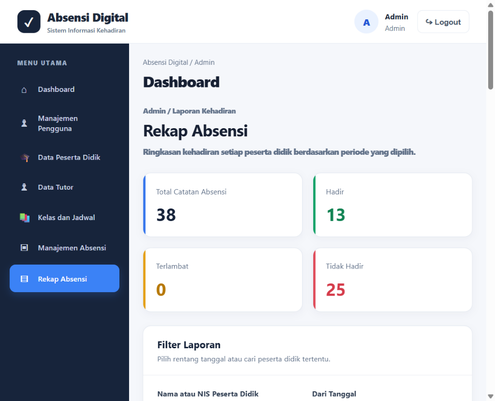
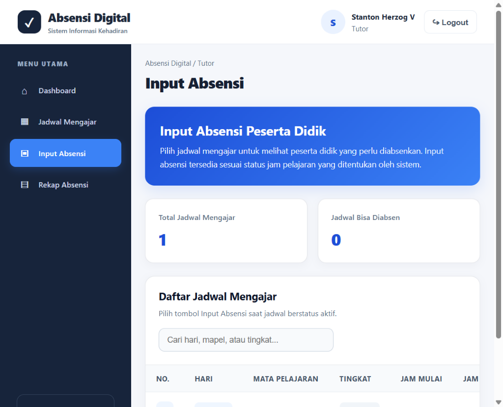
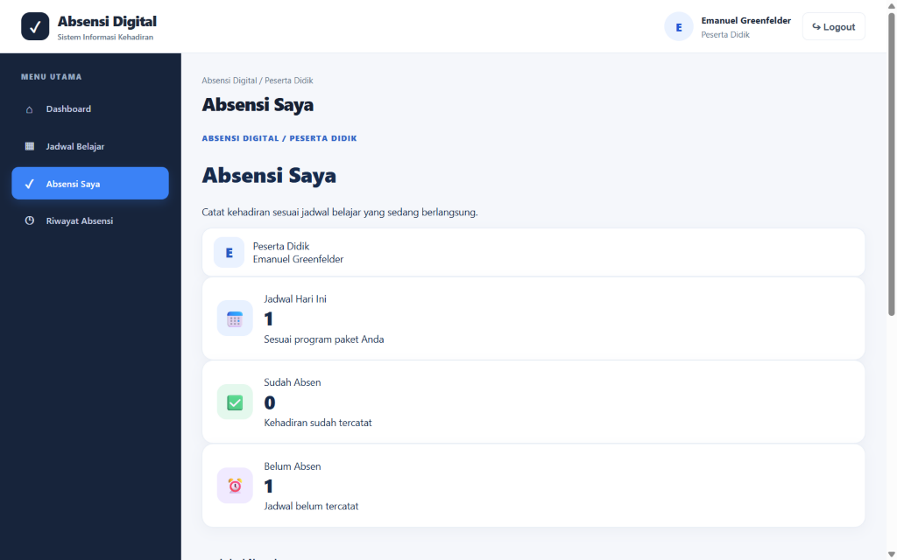
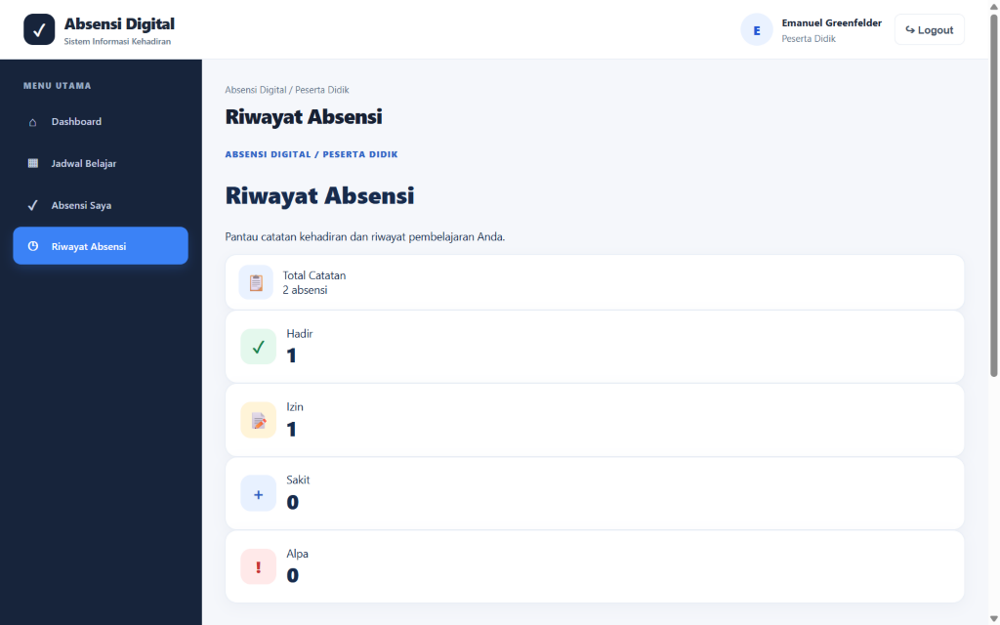

# Dokumen Quality Assurance (QA) — Black Box & White Box Testing

**Nama Proyek:** Sistem Aplikasi Absensi Digital pada PKBM "PEMUDA"  
**Repository GitHub:** https://github.com/irulxz/aplikasi-absensi-digital  
**Tanggal Pengujian:** 25 November 2026  
**Lingkungan Uji:** Laragon Local Web Server (`http://aplikasi-absensi-digital.test`), PHP 8.4.21, Laravel 12, MySQL (`pkbm_pemuda`), PHPUnit 11.5.57  

**Tim Proyek (Kelompok 3):**
| No | Nama Anggota | NIM | Peran |
|---:|---|---|---|
| 1 | Muhammad Nurul Mudzakkir | 2495114014 | Project Manager |
| 2 | Mochamad Basa | 2495114005 | Requirement Analyst |
| 3 | **Bowie Al-Ghoffar** | **2495114011** | **Reviewer / QA** |

**Dokumen Acuan:**
- [dokumen_kebutuhan.md](../dokumen_kebutuhan.md)
- [materi.md](../materi.md) (*Black Box Testing Vs White Box Testing*)

---

## 1. Ringkasan Eksekutif

Pengujian Quality Assurance (QA) dilakukan terhadap seluruh modul aplikasi **Sistem Aplikasi Absensi Digital PKBM "PEMUDA"** mencakup peran **Admin/Pengelola PKBM**, **Pengajar/Tutor**, dan **Peserta Didik**, termasuk fitur baru peserta didik (**Absensi Saya** pada `PesertaAbsensiController` dan **Riwayat Absensi** pada `PesertaRiwayatAbsensiController`).

Mengacu pada [materi.md](../materi.md), QA menggabungkan dua pendekatan yang saling melengkapi:
1. **Black Box Testing:** Pengujian fungsional dan perilaku sistem dari sudut pandang pengguna akhir pada aplikasi berjalan (`http://aplikasi-absensi-digital.test`), mencakup validasi input, alur kerja tiap peran, pembatasan hak akses, pencarian, responsivitas tampilan, dan waktu respons.
2. **White Box Testing:** Pengujian struktur internal kode, percabangan (*branch*), kondisi (*condition*), batas nilai (*boundary*), transaksi database, serta isolasi data menggunakan *automated test suite* PHPUnit (`tests/Unit` dan `tests/Feature`).

### Ringkasan Hasil Pengujian
| Aspek Pengujian | Cakupan | Hasil | Keterangan |
|---|---|---|---|
| **White Box Testing (PHPUnit)** | Unit Test (`tests/Unit`) & Feature Test (`tests/Feature`) | **29/29 PASS** (216 assertions, 14.14s) | Setelah penyesuaian `ExampleTest` root redirect (`/ -> /login`). |
| **Black Box Testing (Browser Live)** | Login, Role Admin, Role Tutor, Role Peserta Didik (termasuk Absensi Saya & Riwayat Absensi), Cross-Role 403, Mobile Viewport | **18/18 Skenario PASS** | Diuji langsung di Laragon tanpa memodifikasi data produksi lokal. |
| **Performa (NFR-01)** | Waktu respons HTTP (`/login`, `/`, dan suite HTTP test) | **PASS** (0.48s – 0.59s) | Jauh di bawah batas maksimal 5 detik. |
| **Temuan Defect / Catatan QA** | Audit kode, migrasi, route, UI, dan skema DB | **7 Temuan** (1 Medium, 6 Low/Minor) | Didokumentasikan pada Bagian 6 untuk tindak lanjut pengembang. |

---

## 2. Metodologi Pengujian (Mengacu pada `materi.md`)

| Aspek | Black Box Testing | White Box Testing |
|---|---|---|
| **Definisi** | Mengevaluasi perilaku perangkat lunak dari luar tanpa memeriksa implementasi kode internal. | Memeriksa kode internal, struktur, percabangan, kondisi, dan alur eksekusi aplikasi. |
| **Fokus** | Input, output, pesan notifikasi, navigasi UI, dan perilaku sistem yang terlihat oleh pengguna. | *Statements*, *branches*, *conditions*, *loops*, *execution paths*, transaksi DB, dan validasi server. |
| **Teknik yang Diterapkan** | *Equivalence Partitioning* (valid vs invalid input), *Boundary Value Analysis* (di dalam/di luar jam jadwal), *Decision Table Testing* (kombinasi peran × endpoint), *State Transition Testing* (login -> dashboard -> absen -> logout). | *Statement Coverage*, *Branch Coverage* (`if/else`, `switch`, `abort_unless`), *Path Coverage* (alur sukses, gagal, duplikasi), dan *Condition Coverage* (batas jam `>=`, `<=`, `<`). |
| **Level Pengujian** | System Testing & Acceptance Testing (browser pada `http://aplikasi-absensi-digital.test`). | Unit Testing (`tests/Unit/WhiteBoxUnitTest.php`) & Feature/Integration Testing (`tests/Feature/*`). |

---

## 3. Requirement Traceability Matrix (RTM)

| Kode Kebutuhan | Deskripsi Singkat | Test Case Black Box | Test Case White Box (PHPUnit) | Status |
|---|---|---|---|---|
| **F-01** | Login multi-role & pembedaan hak akses | `BB-01`, `BB-02`, `BB-03`, `BB-04`, `BB-05` | `AuthAndRoleAccessTest`, `WhiteBoxUnitTest` (RoleMiddleware) | PASS |
| **F-02 / US-03** | Admin mengelola data peserta didik, user, tutor, jadwal | `BB-06`, `BB-07`, `BB-08`, `BB-09` | `AdminManagementTest` | PASS (catatan `DEF-01`) |
| **F-03 / US-01 / UC-01** | Peserta didik melakukan absensi digital & melihat riwayat | `BB-13`, `BB-14`, `BB-15`, `BB-16` | `PesertaAbsensiAndRiwayatTest`, `WhiteBoxUnitTest` | PASS (catatan `DEF-04`, `DEF-05`) |
| **F-04 / US-02** | Pengajar/Tutor memantau & mengelola absensi sesuai jadwal | `BB-10`, `BB-11`, `BB-12` | `TutorWorkflowTest`, `WhiteBoxUnitTest` | PASS |
| **F-05 / US-03** | Admin melihat & mengekspor rekapitulasi absensi | `BB-09` | `AdminManagementTest::test_admin_manajemen_absensi_rekap_dan_export_csv` | PASS |
| **NFR-01** | Waktu respons maksimal 5 detik | `BB-18` | Seluruh feature test (`0.05s – 0.67s` per kasus utama) | PASS |
| **NFR-02 / SC-02** | Keamanan password hash, RBAC 3 peran, proteksi akses | `BB-02`, `BB-04`, `BB-05`, `BB-12` | `WhiteBoxUnitTest::test_user_model_keamanan_password_hash...`, `AuthAndRoleAccessTest` | PASS |
| **NFR-03** | Usability, pesan sukses/gagal, responsif desktop & mobile | `BB-14`, `BB-15`, `BB-17` | Verifikasi session flash (`success`, `error`) & rendering view | PASS (catatan `DEF-07`) |
| **NFR-04** | Reliability, anti-duplikasi absensi pada hari & jadwal sama | `BB-14`, `BB-15` | `PesertaAbsensiAndRiwayatTest::test_peserta_tidak_dapat_absen_ganda_atau_menimpa_status_tutor` | PASS |
| **SC-01** | Aplikasi web berbasis Laravel & MySQL/MariaDB | `BB-01` s.d. `BB-18` | `composer.json` (Laravel 12), `.env` (`mysql` / `pkbm_pemuda`) | PASS |

---

## 4. Hasil Black Box Testing (Laragon Live Server)

Pengujian Black Box dijalankan langsung pada browser terhadap `http://aplikasi-absensi-digital.test` dengan data database `pkbm_pemuda` aktif:

| ID | Fitur / Modul | Skenario Uji | Input / Aksi | Hasil yang Diharapkan | Hasil Aktual | Status |
|---|---|---|---|---|---|---|
| **BB-01** | Halaman Login | Akses root `/` dan `/login` | Buka `/` lalu `/login` | `/` redirect ke `/login`; form Email & Password tampil | Redirect `302` ke `/login`, form tampil lengkap (`200 OK`) | **PASS** |
| **BB-02** | Login (Negatif) | Login dengan password salah | `admin@gmail.com` / `wrongpass` | Login ditolak, muncul pesan error, input email dipertahankan | Muncul banner `"Email atau password salah."`, email tetap terisi | **PASS** |
| **BB-03** | Login Multi-Role | Login sebagai Admin, Tutor, dan Peserta Didik | Akun valid tiap peran (`admin@gmail.com`, `nfarrell@example.com`, `hodkiewicz.rusty@example.org`) | Diarahkan ke dashboard masing-masing (`/admin/dashboard`, `/tutor/dashboard`, `/peserta/dashboard`) | Setiap peran diarahkan ke dashboard yang sesuai | **PASS** |
| **BB-04** | Logout | Keluar dari sesi aktif | Klik tombol `Logout` di header | Sesi berakhir, redirect `/login` + notifikasi sukses | Redirect ke `/login` dengan pesan `"Kamu berhasil logout."` | **PASS** |
| **BB-05** | Kontrol Akses (RBAC) | Akses URL lintas peran | Admin buka `/peserta/dashboard`; Tutor buka `/admin/dashboard`; Peserta buka `/admin/dashboard` & `/tutor/dashboard` | Semua akses lintas peran ditolak (`403 Forbidden`) | Tampil halaman `403 \| ANDA TIDAK MEMILIKI AKSES KE HALAMAN INI.` | **PASS** |
| **BB-06** | Admin — Pengguna | Lihat daftar pengguna | Buka `/admin/users` | Menampilkan tabel pengguna beserta role | Tampil `50` pengguna terdaftar dalam tabel | **PASS** |
| **BB-07** | Admin — Peserta & Tutor | Lihat daftar peserta didik dan tutor | Buka `/admin/peserta-didik` dan `/admin/tutor` | Menampilkan data peserta (`program_paket`, status akun) & tutor (`NIP`) | Tampil `34` peserta didik (paginasi 10/hal) dan `8` tutor | **PASS** |
| **BB-08** | Admin — Kelas & Jadwal | Lihat daftar kelas dan jadwal | Buka `/admin/kelas` | Menampilkan tabel mata pelajaran, tutor, hari, jam | Tampil `19` jadwal ditemukan | **PASS** |
| **BB-09** | Admin — Absensi & Rekap | Lihat manajemen absensi & rekap absensi | Buka `/admin/absensi` & `/admin/rekap-absensi` | Ringkasan Hadir/Terlambat/Tidak Hadir, filter, & tombol Ekspor ke Excel tampil | Total `38` catatan (`13` Hadir, `25` Tidak Hadir), rekap `27` peserta tampil | **PASS** |
| **BB-10** | Tutor — Dashboard & Jadwal | Pantau jadwal mengajar milik tutor | Buka `/tutor/dashboard` dan `/tutor/jadwal` | Hanya menampilkan jadwal milik tutor login (`Stanton Herzog V`) | Tampil `1` jadwal (`Bahasa Inggris`, Minggu `10:10–11:11`, Paket C) | **PASS** |
| **BB-11** | Tutor — Input Absensi | Cek ketersediaan tombol input absensi di luar jam | Buka `/tutor/absensi` saat jadwal di luar jam pelajaran | Tombol input nonaktif dengan keterangan di luar jam pelajaran | Status `"Di luar jam pelajaran"`, kolom aksi `"Belum tersedia"` | **PASS** |
| **BB-12** | Tutor — Rekap Absensi | Lihat rekap absensi per mata pelajaran & paket | Buka `/tutor/rekap-absensi` | Rekap terkelompok per mata pelajaran dan program paket tutor | Tampil kelompok `Bahasa Inggris \| Program Paket C \| 0 catatan absensi` | **PASS** |
| **BB-13** | Peserta — Dashboard & Jadwal | Cek statistik kehadiran & jadwal sesuai Paket A | Login `hodkiewicz.rusty@example.org`, buka `/peserta/dashboard` & `/peserta/jadwal` | Statistik kehadiran & hanya jadwal Paket A yang tampil | Tampil `1 Hadir, 1 Izin (50%)`, dan `11` jadwal Paket A | **PASS** |
| **BB-14** | Peserta — Absensi Saya (Baru) | Cek daftar jadwal hari ini, tombol di luar jam, & fitur pencarian | Buka `/peserta/absensi` (hari Rabu), cari `XYZ_TIDAK_ADA`, lalu klik reset | Jadwal hari Rabu tampil berstatus `Menunggu` & tombol `Di Luar Jam Absensi` nonaktif; pencarian kosong tampilkan state kosong & reset memulihkan daftar | Kartu `Bahasa Inggris (19:00–22:00)` tampil, pencarian `0 dari 1 jadwal`, reset mengembalikan `1 dari 1 jadwal` | **PASS** |
| **BB-15** | Peserta — Riwayat Absensi (Baru) | Cek tabel riwayat, ringkasan, & pencarian klien | Buka `/peserta/riwayat-absensi`, cari `XYZ_TIDAK_ADA`, lalu reset | Tabel riwayat urut terbaru, ringkasan konsisten, pencarian & reset berfungsi | Tampil `2 absensi` (`1 Hadir`, `1 Izin`), pencarian tampilkan `"Riwayat Tidak Ditemukan"`, reset pulih | **PASS** |
| **BB-16** | Peserta — Konsistensi Absen Ganda & Jam | Uji absen dalam jam belajar, batas jam, & pencegahan duplikasi | Diverifikasi melalui test HTTP transaksional (lihat `WB` `PesertaAbsensiAndRiwayatTest`) | Absen berhasil saat jam valid; duplikasi ditolak dengan pesan error | Berfungsi sesuai `UC-01` & `NFR-04` | **PASS** |
| **BB-17** | Responsivitas Mobile (NFR-03) | Uji tampilan halaman baru pada ukuran layar HP | Viewport `390x844` pada `/peserta/absensi` | Layout tersusun vertikal rapi tanpa horizontal overflow | Layout rapi (`main` width `375.2px`), tombol dan kartu mudah diakses | **PASS** |
| **BB-18** | Performa (NFR-01) | Ukur waktu respons halaman | Permintaan HTTP ke `/` dan `/login` | Waktu respons `<= 5 detik` | `/login`: `0.476s`, `/`: `0.595s` | **PASS** |

### Bukti Screenshot Hasil Pengujian Live (Laragon)
1. **Halaman Rekap Absensi Admin (`/admin/rekap-absensi`):**  
   
2. **Halaman Input Absensi Tutor (`/tutor/absensi`):**  
   
3. **Halaman Absensi Saya Peserta Didik — Fitur Baru (`/peserta/absensi`):**  
   
4. **Halaman Riwayat Absensi Peserta Didik — Fitur Baru (`/peserta/riwayat-absensi`):**  
   

---

## 5. Hasil White Box Testing (Analisis Kode & PHPUnit)

Pengujian White Box menganalisis alur eksekusi internal, percabangan (*branch*), kondisi (*condition*), dan transaksi database pada berkas sumber utama, kemudian mengujinya secara otomatis menggunakan PHPUnit (`php artisan test`) dengan `DatabaseTransactions` agar database `pkbm_pemuda` tetap bersih.

### 5.1 Analisis Jalur & Kondisi Kritis (White Box Inspection)
1. **`App\Http\Middleware\RoleMiddleware::handle()`**
   - *Path 1:* `!$request->user()` -> redirect ke `route('login')`.
   - *Path 2:* `$request->user()->role !== $role` -> `abort(403)`.
   - *Path 3:* `$request->user()->role === $role` -> meneruskan ke `$next($request)`.
2. **`App\Http\Controllers\AuthController::login()`**
   - Validasi input `email` (`required|email`) dan `password` (`required|string`).
   - *Branch gagal autentikasi:* `Auth::attempt` false -> `back()->withErrors(['email' => ...])->onlyInput('email')`.
   - *Switch role:* 4 jalur (`admin`, `tutor`, `peserta_didik`, dan `default` yang memaksa logout + invalidate session).
3. **`App\Http\Controllers\PesertaAbsensiController::store()` (Fitur Baru)**
   - *Guard 1:* `PesertaDidik::where('user_id', Auth::id())->firstOrFail()`.
   - *Guard 2:* `Jadwal::whereKey($jadwalId)->where('program_paket', $peserta->program_paket)->firstOrFail()` (mencegah peserta mengakses jadwal paket lain).
   - *Guard 3 (Hari):* `abort_unless($jadwal->hari === $this->hariIndonesia(), 403)`.
   - *Guard 4 (Rentang Waktu):* `abort_unless($waktuSekarang >= $jamMulai && $waktuSekarang <= $jamSelesai, 403)`.
   - *Guard 5 (Anti-Duplikasi & Race Condition):* Pengecekan awal `sudahAbsen`, dilanjutkan `DB::transaction` dengan `lockForUpdate()`, pengecekan ulang di dalam transaksi (`RuntimeException('ABSENSI_SUDAH_TERCATAT')`), serta penangkapan `QueryException` kode MySQL `1062` (pelanggaran unique key).
4. **`App\Http\Controllers\PesertaRiwayatAbsensiController::index()` (Fitur Baru)**
   - Mengambil relasi `absensis()` milik peserta yang login saja (`PesertaDidik::where('user_id', Auth::id())->firstOrFail()`), eager loading `jadwal.mataPelajaran` & `jadwal.tutor`, urutan `orderByDesc('tanggal')->orderByDesc('id')`, dan `paginate(10)`.
5. **`App\Http\Controllers\TutorAbsensiController::jadwalSedangBerlangsung()` & `store()`**
   - Memastikan kepemilikan jadwal (`$jadwal->tutor_id === $tutor->id`), validasi waktu zona `Asia/Jakarta` (`greaterThanOrEqualTo($mulai) && lessThan($selesai)`), validasi status `in:Hadir,Izin,Sakit,Alpa`, validasi peserta satu `program_paket` (`abort_if(..., 422)`), serta `Absensi::updateOrCreate(...)`.

### 5.2 Ringkasan Eksekusi Automated Test Suite (`php artisan test`)
Seluruh test suite dieksekusi setelah penulisan lengkap Unit & Feature test:

| File Test Suite | Jenis | Jumlah Test | Hasil | Fokus Uji |
|---|---|---|---|---|
| [tests/Unit/ExampleTest.php](../tests/Unit/ExampleTest.php) | Unit | 1 | PASS | Dasar PHPUnit |
| [tests/Unit/WhiteBoxUnitTest.php](../tests/Unit/WhiteBoxUnitTest.php) | Unit (White Box) | 8 | PASS | Password hash & hidden field User, table/fillable/relasi semua model, 3 branch `RoleMiddleware`, 7 hari `hariIndonesia()`, BVA `jadwalSedangBerlangsung()` |
| [tests/Feature/ExampleTest.php](../tests/Feature/ExampleTest.php) | Feature | 1 | PASS | Redirect root `/` ke `/login` |
| [tests/Feature/AuthAndRoleAccessTest.php](../tests/Feature/AuthAndRoleAccessTest.php) | Feature | 6 | PASS | Login multi-role, kredensial salah/kosong, role tidak dikenal, logout, proteksi guest & cross-role 403 |
| [tests/Feature/AdminManagementTest.php](../tests/Feature/AdminManagementTest.php) | Feature | 4 | PASS | CRUD User (termasuk anti self-delete), CRUD Peserta Didik, CRUD Tutor & Jadwal + validasi jam, Manajemen Absensi, Rekap & Export CSV |
| [tests/Feature/TutorWorkflowTest.php](../tests/Feature/TutorWorkflowTest.php) | Feature | 3 | PASS | Dashboard/Jadwal/Rekap Tutor, penolakan 403 jadwal tutor lain / luar jam, simpan & update absensi, validasi status & lintas paket 422 |
| [tests/Feature/PesertaAbsensiAndRiwayatTest.php](../tests/Feature/PesertaAbsensiAndRiwayatTest.php) | Feature (Fitur Baru + Peserta) | 6 | PASS | Dashboard & Jadwal Paket, Absensi Saya (`index` & `store`), BVA tepat `jam_mulai`/`jam_selesai` & 1 detik di luar batas, penolakan hari/paket/role salah, anti-duplikasi & tidak menimpa status Tutor, isolasi/urutan/paginasi Riwayat Absensi |
| **TOTAL** | **Unit + Feature** | **29 Test** | **29 PASS (216 Assertions)** | **Durasi total: 14.14 detik** |

---

## 6. Daftar Temuan Defect / Catatan QA (Bug Report)

Selama inspeksi White Box dan pengujian Black Box, ditemukan beberapa defect / ketidaksesuaian yang perlu diperhatikan:

| ID | Tingkat | Lokasi Kode / Halaman | Deskripsi Temuan | Dampak & Rekomendasi |
|---|---|---|---|---|
| **DEF-01** | **Medium** | `database/migrations/`, `app/Models/Jadwal.php`, `app/Http/Controllers/JadwalController.php`, `resources/views/admin/kelas/create.blade.php` | Kolom `jadwals.program_paket` dan unique key `absensis_peserta_jadwal_tanggal_unique` terdapat pada database MySQL live (`pkbm_pemuda`), namun file migrasi `add_program_paket_to_jadwals_table` hanya ada di branch `origin/feat/kelas-dan-jadwal` dan belum tergabung ke `main`. Selain itu, `Jadwal::$fillable` dan `JadwalController` belum menerima input `program_paket`. | Jadwal baru yang dibuat Admin dari UI selalu tersimpan sebagai default `Paket A` dan `migrate:fresh` pada `main` berisiko gagal pada query `program_paket`. **Rekomendasi:** Gabungkan migrasi `program_paket` & unique index `absensis` ke `main`, lalu tambahkan field `program_paket` pada `Jadwal::$fillable`, `JadwalController`, dan form kelas. |
| **DEF-02** | **Low** (Fixed in QA) | `tests/Feature/ExampleTest.php` | Pada kondisi awal sebelum QA, `ExampleTest` gagal (`Expected 200, received 302`) karena route `/` mengarahkan pengguna ke `/login`. | Suite test default gagal jika tidak disesuaikan. **Status:** Telah diperbarui pada suite QA menjadi `assertRedirect(route('login'))`. |
| **DEF-03** | **Low** | `routes/web.php` (baris 71–73 vs 245–248) | Terdapat definisi ganda untuk route `GET /peserta/dashboard` bernama `peserta.dashboard` (closure tanpa data `$peserta` di baris 71 dan controller `PesertaDashboardController@index` di baris 245). | Saat ini tertimpa oleh route kedua sehingga tetap jalan, tetapi membingungkan dan berisiko error `Undefined variable $peserta` jika urutan route berubah. **Rekomendasi:** Hapus definisi closure duplikat pada baris 71–73. |
| **DEF-04** | **Low** | `app/Http/Controllers/PesertaAbsensiController.php` (baris 76–77) vs `TutorAbsensiController.php` (baris 228–229) | Batas waktu akhir absensi Peserta menggunakan operator inklusif (`<= $jamSelesai`), sedangkan Tutor menggunakan eksklusif (`lessThan($selesai)`). Pada detik tepat `jam_selesai`, peserta masih bisa absen sementara tutor sudah ditolak 403. | Perbedaan perilaku kecil pada batas detik terakhir jam belajar. **Rekomendasi:** Samakan kebijakan operator waktu di kedua controller. |
| **DEF-05** | **Low** | `resources/views/peserta/riwayat-absensi.blade.php` (baris 32–44) | Kartu ringkasan (`Hadir`, `Izin`, `Sakit`, `Alpa`) dihitung dari `$absensis->getCollection()` (maksimal 10 data pada halaman aktif), sementara `Total Catatan` di header menghitung `$absensis->total()` (seluruh halaman). | Jika riwayat melebihi 10 baris, jumlah pada 4 kartu ringkasan tidak sama dengan `Total Catatan`. **Rekomendasi:** Hitung rekap status melalui query agregasi controller atas seluruh riwayat peserta. |
| **DEF-06** | **Low** | `PesertaAbsensiController.php`, `PesertaRiwayatAbsensiController.php`, `PesertaJadwalController.php` | Menggunakan `PesertaDidik::where('user_id', Auth::id())->firstOrFail()` sehingga memunculkan halaman `404` jika akun `peserta_didik` belum memiliki profil di tabel `peserta_didik`, berbeda dengan `PesertaDashboardController` yang menanganinya secara ramah. | Pengalaman pengguna kurang informatif bila admin baru membuat user tanpa mengisi profil peserta didik. **Rekomendasi:** Tampilkan pesan peringatan yang ramah seperti di dashboard peserta. |
| **DEF-07** | **Minor (UI & Data)** | `admin/tutor/index.blade.php`, `peserta/jadwal.blade.php`, `peserta/riwayat-absensi.blade.php`, `database/factories/JadwalFactory.php` | 1) Judul `<title>` dan heading atas pada `/admin/tutor` serta `/peserta/jadwal` masih bertuliskan `"Dashboard"`. 2) `JadwalFactory` mengacak `jam_mulai` dan `jam_selesai` secara independen sehingga menghasilkan beberapa data seed dengan `jam_selesai <= jam_mulai` (mis. `13:00–09:00`). 3) Pada viewport `1280x800`, kolom `Status` di `/peserta/riwayat-absensi` membutuhkan horizontal scroll tabel (`min-width: 850px`). | Ketidakkonsistenan label UI dan data uji awal yang tidak realistis. **Rekomendasi:** Perbaiki `@section('title')` / `@section('page-title')`, sesuaikan `JadwalFactory` agar `jam_selesai > jam_mulai`, dan perkecil `min-width` tabel riwayat. |

---

## 7. Kesimpulan & Rekomendasi

1. Secara fungsional maupun struktur kode internal, **Aplikasi Absensi Digital PKBM "PEMUDA"** telah memenuhi seluruh kebutuhan utama (`F-01`–`F-05`), kebutuhan nonfungsional (`NFR-01`–`NFR-04`), batasan sistem (`SC-01`–`SC-02`), serta *User Story* dan *Use Case* (`US-01`–`US-03`, `UC-01`).
2. Fitur baru yang belum di-commit (**Absensi Saya** dan **Riwayat Absensi** untuk Peserta Didik) berjalan dengan baik pada pengujian Black Box maupun White Box: jadwal tersaring sesuai hari dan `program_paket`, absensi hanya bisa dilakukan dalam rentang jam belajar, duplikasi dan penimpaan status Tutor berhasil dicegah oleh transaksi database dan unique constraint, serta riwayat terisolasi dan terpaginasi dengan benar.
3. Dengan dilengkapinya **29 automated test PHPUnit (216 assertions)** di repository GitHub dan daftar temuan defect di dokumen ini, tim pengembang memiliki basis regresi otomatis untuk menjaga stabilitas aplikasi saat melakukan perbaikan `DEF-01` s.d. `DEF-07` pada iterasi berikutnya.
